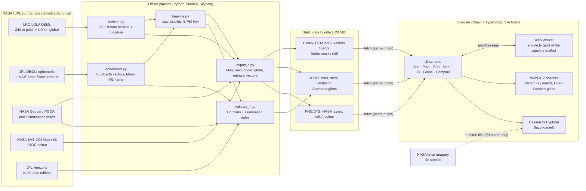
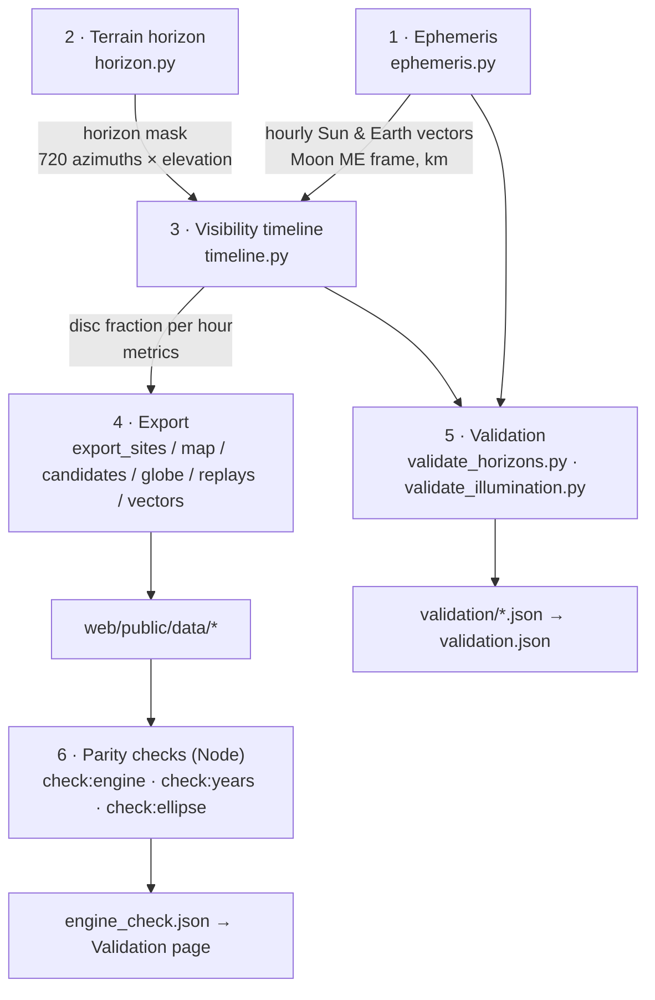
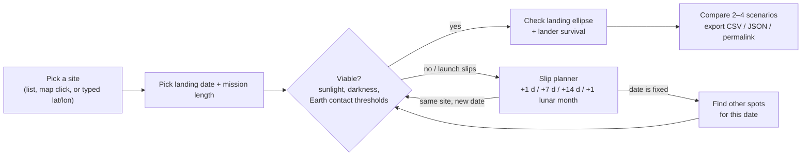

<div align="center">

# Lunar Statio
### South Pole Mission Planner

**Sun for power. Earth for a voice home. See both, for any spot near the lunar south pole, at any hour.**

NASA Space Apps Challenge 2026 · Challenge: *Lunar Landing Site Navigator* · **Team Stranded**
Dr. D.Y. Patil Institute of Technology, Pune

[](https://lunar-mission-explorer.vercel.app)


-4a515a)


</div>

---

## Contents

1. [Overview](#1-overview)
2. [The problem](#2-the-problem)
3. [What the app does](#3-what-the-app-does)
4. [System architecture](#4-system-architecture)
5. [Data pipeline](#5-data-pipeline)
6. [User workflow](#6-user-workflow)
7. [Algorithms and models](#7-algorithms-and-models)
8. [Data providers and external services](#8-data-providers-and-external-services)
9. [Tech stack](#9-tech-stack)
10. [Validation and accuracy](#10-validation-and-accuracy)
11. [Performance and engineering decisions](#11-performance-and-engineering-decisions)
12. [Repository structure](#12-repository-structure)
13. [Run it yourself](#13-run-it-yourself)
14. [Assumptions and limitations](#14-assumptions-and-limitations)
15. [Future work](#15-future-work)
16. [Use of AI tools](#16-use-of-ai-tools)
17. [Team Stranded](#17-team-stranded)
18. [References and acknowledgements](#18-references-and-acknowledgements)

---

## 1. Overview

**Lunar Statio** is a browser-based mission-planning tool for the Moon's south pole. For any site and any hour it shows whether the **Sun** (power) and the **Earth** (direct-to-Earth radio contact) are above the site's **real terrain horizon**, and how that changes over a lunar day, a lunar month and a full year of seasons.

It turns NASA elevation data and JPL planetary ephemerides into answers a planner can act on in seconds:

- *Is this site sunlit and in contact with Earth right now, and for how long?*
- *The launch slipped 14 days. Is the landing still viable? When does the next window open?*
- *The date is fixed. Which spots within 20 km still meet the mission's power and comms needs?*

The heavy physics runs once, offline, in Python. The browser then reproduces the same maths in a Web Worker for any point the user clicks, with **no backend server**. Every number is checked against an independent NASA reference (Section 10).

> **Why "Statio"?** In IAU lunar nomenclature, *Statio* is the Latin name given to landing sites: *Statio Tranquillitatis* (Apollo 11), *Statio Shiv Shakti* (Chandrayaan-3). Lunar Statio is a tool for choosing the next one.

**Live:** [lunar-mission-explorer.vercel.app](https://lunar-mission-explorer.vercel.app) · mirror: [lunar-mission-planner-three.vercel.app](https://lunar-mission-planner-three.vercel.app)
Laptop screens first (tested at 1280×720, 1366×768, 1920×1080). Needs a WebGL 2 browser.

---

## 2. The problem

The Moon's spin axis is tilted only **~1.5°** from its orbital plane. At the south pole the Sun therefore circles the sky **within about 1.6° of a flat horizon**. A ridge tens of kilometres away can hide it for days. Earth wobbles in and out of view by roughly ±7° because of **libration**, so direct-to-Earth (DTE) contact comes and goes on a monthly cycle.

| Consequence | Why it matters |
|---|---|
| A few kilometres change everything | One rim may get 80% sunlight a year while a crater floor next to it gets none (permanently shadowed regions, PSRs). |
| A few days change everything | A site that is perfect on 10 January may be in a multi-day darkness on 24 January. |
| No atmosphere | No refraction and no twilight: the horizon is pure geometry (terrain plus lunar curvature). |

The data to answer these questions exists, but in specialist tools (NASA LRO QuickMap, Moon Trek, JPL Horizons) that take expert workflows to combine. The challenge brief names the gap directly: **rapid comparison of sites and dates, especially after a launch slip.** Lunar Statio is built for that re-planning loop.

---

## 3. What the app does

| Screen | What it answers | Highlights |
|---|---|---|
| **Front page** | What is this, and is it trustworthy? | A technical note: NASA's long-term sunlight map of 85–90° S with the live Sun and Earth bearings from DE421, a year scrubber, method, and live validation numbers. |
| **Site and plan** | Power and comms at this site, now and over the mission | **Horizon dial**: the 360° terrain silhouette as a ring, Sun and Earth moving around it like clock hands. Hero numbers (solar elevation, time to sunset, time to Earthset), Gantt tracks (sunlit / Earth in view / both), year strip, seasons, solar array output in watts, lander battery survival calculator. |
| **Landing-date planner** | When can we land? What does a slip cost? | Viability thresholds → every day marked viable / marginal / not viable on a calendar heatmap. Slip buttons (+1 d, +7 d, +14 d, +1 lunar month) with a before/after card, a **slip budget** ("you can slip N days"), next viable window, best 3 windows. |
| **Landing-ellipse check** | Is the *whole* landing area safe, not just the target? | Samples the uncertainty ellipse, weights each point by a 2D Gaussian landing probability, reports the chance of touching down on ground that meets the mission needs. |
| **Find sites** | Where else can we go on this date? | Ranks **5,487** candidate spots across 85–90° S for the user's exact mission window, then recomputes the top 5 with the exact engine. Filters: slope, sunlight, darkness, Earth view, radius, NASA candidate regions. |
| **South-pole map** | Click anywhere | Polar stereographic map of 85–90° S: LOLA shaded relief, NASA sunlight and Earth-visibility layers, PSRs, slope, NASA's Artemis candidate regions. Clicking computes a new site's horizon and a full year of visibility in the browser. |
| **3D terrain** | What does the shadow look like? | 1024×1024 LOLA mesh of 80–90° S with **GPU ray-marched shadows** (not shadow maps), shadow time-lapse, science lens (mountains vs ice), descent camera. |
| **Whole-Moon globe** | Where is the Sun right now? | The Moon lit from the true Sun direction for the selected hour, LROC colour, LOLA relief normals; Sun/Earth models labelled *not to scale, directions true*. |
| **Moon Explorer** | Context for the public | CesiumJS globe and 2D map with NASA lunar imagery tiles, 24-hour mission clock, 5-stage mission pipeline view. |
| **Compare** | Which scenario wins? | 2–4 site/date scenarios side by side, synced timelines, best value per row highlighted, CSV/JSON export. |
| **Lander systems** | Can a rover reach light and recharge? | Solar recharge planner: candidate recharge spots in range, terrain-sampled route, hour-by-hour energy ledger (solar in, hotel and mobility loads out). |
| **Explainers** | Why does it behave like this? | "Why?" cards linked from the data (axial tilt, libration, ridge blocking, no twilight) and a Moon-vs-Earth contrast ("highest Sun here 1.2°; in your city today 58°"). |
| **Mission replays** | Does the model match reality? | Chandrayaan-3 (Statio Shiv Shakti) and IM-1 Odysseus at their real landing dates, our Sun/Earth visibility next to what ISRO and NASA reported. |
| **Validation** | How accurate is it? | Every check, its result, pass mark and the command that reproduces it, read from the files the checks write. |

**Across all screens:** one shared site + time, any landing year (2024–2040 shipped, any year 1900–2049 on demand), typed or clicked coordinates, permalinks that restore the exact scenario, provenance and resolution on every number, colour-blind-safe meaning colours (amber = Sun, blue = Earth, green = both, grey = neither).

**Curated sites:** Apollo 11, Chandrayaan-3, South Pole–Aitken Basin (far side), IM-1 Odysseus, IM-2 Athena, Blue Ghost Mission 1, Griffin-1 target (Nobile), IM-3 target (Reiner Gamma), Shackleton rim, Mons Mouton, best-lit points and example "safe" sites. Every coordinate carries a cited source.

---

## 4. System architecture

The system is split into an **offline compute tier** (Python, run once) and a **static client tier** (TypeScript in the browser). There is no application server and no database: the deploy is a set of static files on a CDN.



### Design principles

| Principle | How it shows up |
|---|---|
| **Precompute, don't compute live** | Ephemerides, horizons, candidate masks and NASA layers are prepared offline. The browser loads them once; every comparison is instant. |
| **One physics, two runtimes** | `engine.ts` is a line-for-line port of `ephemeris.py` + `horizon.py` + `timeline.py`. A check script proves they agree (Section 10). |
| **Correctness before features** | Phase 1 was gated on matching JPL Horizons. A wrong number does more harm than a missing feature. |
| **Honest labelling** | Simplified models say "simplified index", visual scales say "not to scale", every number shows its source and resolution. |
| **Static and portable** | Any static host works (Vercel today; a GitHub Pages workflow is included). No API keys are needed to run the core app. |

### Runtime components

| Component | Responsibility | Key files |
|---|---|---|
| App shell and state | Routing via query string (`?view=`), shared site/hour/year, permalinks | `web/src/App.tsx`, `data.ts` |
| Data layer | Typed loaders for JSON and binary assets, viability logic, window statistics | `data.ts`, `mapData.ts`, `years.ts` |
| Physics engine | Topocentric Sun/Earth directions, horizon ray march, disc fractions, metrics | `engine.ts`, `engine.worker.ts`, `customPoint.ts` |
| Planner and finder | Viability calendar, slip budget, coarse-to-fine site ranking, landing-ellipse check | `Planner.tsx`, `Finder.tsx`, `ellipseGeometry.ts`, `ellipseCheck.ts` |
| Visualisation | Horizon dial, timelines, seasons, 2D map canvas, 3D terrain, globe | `HorizonDial.tsx`, `Timeline.tsx`, `MapView.tsx`, `Terrain3D.tsx`, `Globe.tsx`, `moonShader.ts` |
| Lander systems | Recharge candidate search, route profile, energy ledger | `web/src/lander/engine/*` |
| Explorer | CesiumJS globe, 2D map, mission clock | `web/src/explorer/*` |
| Evidence | Mission replays, validation page, data sources panel | `Replays.tsx`, `Validation.tsx`, `Sources.tsx` |

---

## 5. Data pipeline



| Stage | Input | Method | Output |
|---|---|---|---|
| **1. Ephemeris** | JPL DE421, lunar PCK/frame kernels | Skyfield computes apparent Sun and Earth vectors from the Moon's centre in the **Moon Mean-Earth/Polar-Axis (ME) DE421** frame. Site position is subtracted, so Earth parallax (up to ~0.26°) is exact. Libration is included by the frame. | `vectors_<year>.f32`: 6 floats per hour (Sun xyz, Earth xyz) |
| **2. Terrain horizon** | LOLA `LDEM_60S_240M` (240 m), `LDEM_16` (~1.9 km) fallback | For every azimuth, march outward along the great circle to 500 km on a 1,737.4 km sphere and keep the highest elevation angle. Curvature drop (≈ d²/2R) is exact by construction. Observer at 2 m mast height. | Horizon mask per site |
| **3. Visibility timeline** | Vectors + horizon mask | For each hour, the visible fraction of the Sun's disc (0.53°) and Earth's disc (~1.9°) above the local horizon. Metrics: sunlit %, Earth-in-view %, both %, longest darkness, longest contact gap, next sunrise/Earthrise, power index. | Per-site hourly tracks + metrics |
| **4. Export** | All of the above + NASA layers | Writes compact binary and JSON assets for the web app: 80–90° S DEM crop (int16), finder candidates (float32) and coarse masks (int8), NASA PGDA layers resampled to our grid (PNG), globe relief normals, replay files. | `web/public/data/**` |
| **5. Validation** | JPL Horizons tables, NASA PGDA maps | Angular error vs Horizons at 3 sites; correlation and median difference vs NASA's 18.6-year illumination maps at 80 random points. **Pass marks fixed before the run**; scripts exit non-zero on failure. | `validation/*.json` |
| **6. Parity** | Python reference points | Node runs the browser engine against Python's results for test points, all years and the finder's coarse stage. | `engine_check.json` |

**Formats.** Binary assets are fixed-layout typed arrays (no parsing cost, direct `Float32Array`/`Int16Array` views). The finder stores 5,487 horizons as int8 in 0.1° steps (5,487 × 360 bytes ≈ 2 MB). A whole year of Sun/Earth vectors is 8,760 × 6 × 4 bytes ≈ 210 KB.

---

## 6. User workflow

The core re-planning loop from the challenge brief, end to end:



1. **Pick a site** from the curated list, click anywhere on the south-pole map, or type coordinates (85–90° S).
2. **Read the dial**: Sun and Earth against the real horizon, with the hero numbers (solar elevation, time to sunset, time to Earthset).
3. **Set mission needs** (length, minimum sunlight, maximum darkness, minimum Earth view). The calendar marks every day viable / marginal / not viable.
4. **Simulate a slip** and read the before/after card and the slip budget.
5. **Find alternatives**: other dates at the same site, or other sites for the same date.
6. **Check the landing area** (ellipse) and **lander survival** (battery vs longest darkness).
7. **Compare** the finalists and share a permalink or export the numbers.

---

## 7. Algorithms and models

> **No machine-learning models are used.** Every output is computed from deterministic physics on published NASA/JPL data. This is a deliberate choice: mission planners need numbers that are reproducible, explainable and checkable against a reference, which a trained model cannot guarantee for this problem.

| # | Algorithm / model | Where | Notes |
|---|---|---|---|
| 1 | **Planetary ephemeris** (JPL DE421 numerical integration, via Skyfield) | `ephemeris.py` | Apparent positions, light-time corrected, in the lunar ME frame (libration included). |
| 2 | **Topocentric transform** to azimuth/elevation | `ephemeris.py`, `engine.ts` | Local east-north-up basis on the lunar sphere; azimuth clockwise from north. |
| 3 | **Terrain horizon ray march** on a sphere | `horizon.py`, `engine.ts` | Great-circle march to 500 km per azimuth; max elevation angle; exact curvature; bilinear DEM sampling in polar stereographic coordinates. |
| 4 | **Partial-disc occultation** (circular segment area) | `timeline.py`, `engine.ts` | Visible fraction = 1 − (arccos x − x·√(1−x²))/π, where x = (el − horizon)/radius. Same "any part visible" rule as NASA's illumination maps. |
| 5 | **Power-potential index** | `timeline.py`, `data.ts` | Visible Sun fraction × cos(elevation) for a vertical, Sun-tracking panel; shown in watts as × 1361 W/m² × area × efficiency. Labelled simplified. |
| 6 | **Viability classification and slip budget** | `data.ts`, `Planner.tsx` | Sliding mission window over hourly tracks; threshold rules → viable / marginal / not viable; forward search for the slip budget and next windows. |
| 7 | **Coarse-to-fine site search** | `export_candidates.py`, `Finder.tsx` | Offline: one best candidate per 2.9 km tile (slope ≤ 15°, highest NASA sunlight + Earth view), coarse 1° horizon. Online: rank all 5,487 for the user's window, recompute the top 5 with the exact 0.5°/120 m engine. |
| 8 | **Landing-ellipse dispersion** | `ellipseGeometry.ts`, `ellipseCheck.ts` | Grid + edge samples in the ellipse frame; landing weight from a 2D Gaussian with the edge at 3σ; chance of landing on viable ground = Σ weights. |
| 9 | **GPU terrain shadows** (fragment-shader ray march) | `Terrain3D.tsx` | Same geometry as `horizon.py`, coarser steps far out. Uses a small-number formulation because float32 cannot subtract ~1,737 km lengths accurately. Shadow maps were rejected (wrong at 1–2° Sun). |
| 10 | **Lunar-Lambert reflectance** | `moonShader.ts` | Blend of Lambert and Lommel-Seeliger, which matches the Moon's weak limb darkening. Normals from LOLA relief. |
| 11 | **Great-circle geometry** (haversine distance, initial bearing) | `mapLoader.ts`, `ellipseGeometry.ts` | Distances and directions on a 1,737.4 km sphere. |
| 12 | **Rover energy ledger** (discrete-time simulation) | `lander/engine/energyModel.ts` | Phases: standby → transit → recharge → science. Energy is conserved each step: E_final = E_initial + solar − hotel − mobility − curtailed. |
| 13 | **Earth solar position** (NOAA solar equations) | `explain/solar.ts` | Only for the Moon-vs-Earth contrast card. |
| 14 | **Statistical validation** (Pearson r, median absolute difference, worst angular error) | `validate_*.py`, `scripts/check-*.ts` | Pass/fail criteria fixed in code before each run. |

---

## 8. Data providers and external services

All science data comes from public NASA / JPL / ISRO / IAU sources. The app needs **no API keys or credentials**. Endpoints and service URLs are intentionally not listed here; sources are fully cited in the app's *Data sources* panel.

| Provider / facility | Dataset or service | Access type | Used for |
|---|---|---|---|
| **NASA LRO – LOLA** (Lunar Orbiter Laser Altimeter), via the PDS Geosciences Node | `LDEM_60S_240M` south polar DEM (240 m), `LDEM_16` global DEM | Offline file download | Terrain horizons, slopes, 2D map relief, 3D terrain, globe relief |
| **NASA JPL – Solar System Dynamics** | DE421 planetary ephemeris | Offline file download | Sun and Earth positions |
| **NASA JPL – NAIF** (SPICE) | Lunar frame and orientation kernels (FK, PCK, binary PCK) | Offline file download | Moon ME frame, libration |
| **NASA JPL – Horizons** ephemeris system | Topocentric Sun/Earth tables for test sites | Queried once offline; stored in `pipeline/reference/` | Independent validation only |
| **NASA Goddard – Planetary Geodesy Data Archive (PGDA)** | Lunar polar illumination and Earth visibility maps (Mazarico et al. 2011) | Offline file download | Map layers, PSRs, finder seeding, validation reference |
| **NASA Scientific Visualization Studio** | CGI Moon Kit (LROC WAC colour) | Offline file download | Globe and Explorer base colour |
| **NASA Solar System Treks** (Moon Trek) | LRO WAC mosaic and LOLA colour-shaded relief tiles | **Runtime** web map tile service (Explorer screen only) | High-resolution imagery in the Cesium Explorer |
| **LROC** (Arizona State University) | Verified landing-site coordinates | Reference | Curated site positions |
| **ISRO** (2026 Space Agency Partner) | Chandrayaan-3 mission updates | Reference | Mission replay facts |
| **NASA** news releases and LRO pages | IM-1 Odysseus landing and operations; Artemis candidate regions (Oct 2024) | Reference | Replay facts, candidate-region overlay |
| **IAU / USGS** Gazetteer of Planetary Nomenclature | Feature names and centres | Reference | Site names, CLPS target centres |
| **NOAA** Global Monitoring Laboratory | Solar position equations | Published method | Earth-side contrast card |

---

## 9. Tech stack

| Layer | Technology | Why |
|---|---|---|
| **Languages** | Python 3, TypeScript, GLSL (WebGL 2 shaders), HTML/CSS | Python for scientific precompute; TypeScript for a typed client; GLSL for per-pixel shadow physics |
| **Scientific computing** | NumPy, Skyfield (with jplephem) | Vectorised DEM and timeline maths; JPL-grade ephemerides without a SPICE toolkit install |
| **Frontend framework** | React 19, Vite 8 | Component model, fast dev server, code-splitting |
| **3D graphics** | three.js | Terrain mesh, custom shaders, globe |
| **Geospatial 3D** | CesiumJS (lazy-loaded) | Moon ellipsoid globe with web map tile layers in the Explorer |
| **2D graphics** | Canvas 2D, hand-drawn SVG | Polar map, horizon dial, timelines and calendars with no charting library |
| **Concurrency** | Web Workers | Click-anywhere horizon and year computation off the main thread |
| **Typography** | Archivo variable (self-hosted) | One family, tabular numerals |
| **Quality** | TypeScript strict build (`tsc -b`), oxlint, Node check scripts | Type safety, lint, physics parity gates |
| **CI/CD and hosting** | Vercel (static), GitHub Actions workflow for GitHub Pages | Zero-server deploy; SPA rewrites in `vercel.json` |
| **Version control** | Git, GitHub | Feature branches per workstream |

**Runtime dependencies (web):** `react`, `react-dom`, `three`, `cesium`, `@fontsource-variable/archivo`. **Pipeline:** `skyfield`, `numpy`.

---

## 10. Validation and accuracy

Every result below is produced by a script in this repository and shown on the in-app **Validation** page, read from the files those scripts write.

| Check | Reference | Result | Pass mark |
|---|---|---|---|
| Sun/Earth directions | **NASA JPL Horizons**, 4,326 directions, 3 sites, Jan 2027 | worst error **0.000033°** (0.12″) | ≤ 0.01° |
| Long-term sunlight | **NASA PGDA** LOLA illumination (Mazarico et al. 2011), 80 points, 18.6-year cycle | **r = 0.991**, median diff 0.31 pp | r ≥ 0.9, ≤ 5 pp |
| Long-term Earth visibility | Same, Earth visibility map | **r = 0.995**, median diff 0.17 pp | r ≥ 0.9, ≤ 5 pp |
| Browser engine vs Python | Python results at 8 test points | direction diff **3.49 × 10⁻⁷°**, sunlit / Earth % diff **0.00 pp** | 0.001°, 0.5 pp |
| Any-year recomputation vs pipeline | 2027 pipeline files, all sites | elevation ≤ 0.001°, metrics ≤ 0.05 pp | — |
| Finder coarse estimate vs exact | 12 of 5,487 spots, full year | worst **0.28 pp** | ≤ 3 pp |
| GPU 3D shadows vs pipeline | 192 Sun/Earth visible-or-not values | **191 / 192** agree (the miss: Sun's upper edge 0.004° from the terrain) | — |
| Mission replays | ISRO (Chandrayaan-3), NASA (IM-1) reports | Modelled Sun/Earth visibility shown next to the agencies' reported operations | Qualitative |

---

## 11. Performance and engineering decisions

- **Zero backend.** All computation is either precomputed or done client-side, so the app scales on a CDN and has no server to secure or keep alive.
- **Off-main-thread physics.** A map click runs a 720-azimuth horizon march and 8,760 hourly evaluations inside a Web Worker; the UI stays responsive.
- **Typed binary assets.** DEM, vectors and finder masks load as `ArrayBuffer`s and are read through typed-array views, with no JSON parsing for large data.
- **Coarse-to-fine search.** Ranking 5,487 spots uses cheap 1° masks; only the top 5 pay for the exact engine.
- **Store horizons, not timelines.** Each site's horizon is stored once; the browser recomputes any year from that year's vector file (~210 KB), so 17 years ship in ~3.6 MB.
- **GPU numerics.** The shadow shader avoids subtracting two ~1,737 km lengths in float32 by working in small local offsets.
- **Code-splitting.** CesiumJS (the largest dependency) loads only on the Explorer screen; the front page ships without three.js.
- **Accessibility.** CVD-checked meaning colours, colour never the only cue, keyboard-reachable controls, `prefers-reduced-motion` honoured.
- **Reproducibility.** Pass criteria are fixed in code before each check runs; data exports regenerate byte-identical.

---

## 12. Repository structure

```text
.
├── pipeline/                  Offline Python pipeline
│   ├── ephemeris.py           Sun/Earth vectors (Skyfield, DE421, Moon ME frame)
│   ├── horizon.py             Terrain horizon masks from LOLA, curvature included
│   ├── timeline.py            Disc visibility, metrics, power index
│   ├── export_sites.py        Curated site files
│   ├── export_map.py          80–90° S DEM crop, NASA layers, engine test points
│   ├── export_candidates.py   Finder candidates + coarse horizons
│   ├── export_globe.py        Globe relief normals
│   ├── export_replays.py      Mission replay files
│   ├── export_vectors.py      Sun/Earth vectors for any year (1900–2049)
│   ├── artemis_regions.py     NASA candidate landing regions overlay
│   ├── validate_horizons.py   Gate: vs JPL Horizons
│   ├── validate_illumination.py  Gate: vs NASA LOLA illumination maps
│   ├── sites.json             Curated sites with cited sources
│   └── reference/horizons/    Stored Horizons reference tables
├── validation/                Check outputs (JSON)
├── web/                       Browser app (React + TypeScript + Vite)
│   ├── src/
│   │   ├── engine.ts, engine.worker.ts   Browser port of the pipeline physics
│   │   ├── App.tsx, data.ts, years.ts    Shell, state, data layer
│   │   ├── HorizonDial.tsx, Timeline.tsx, Seasons.tsx, Survival.tsx, Planner.tsx
│   │   ├── Finder.tsx, MapView.tsx, Terrain3D.tsx, Globe.tsx, Compare.tsx
│   │   ├── Ellipse.tsx, ellipseGeometry.ts, ellipseCheck.ts
│   │   ├── Replays.tsx, Validation.tsx, Sources.tsx
│   │   ├── explain/           "Why?" cards, Moon-vs-Earth contrast
│   │   ├── explorer/          CesiumJS Moon Explorer, mission clock
│   │   └── lander/            Solar recharge planner (engine + components)
│   ├── scripts/               check-engine, check-years, check-ellipse, check-coords
│   └── public/data/           Precomputed assets (binary, JSON, images)
├── docs/                      Pitch, QA checklist, task briefs, figures
├── PROJECT_PLAN.md            Living plan, decision log, change log
└── .github/workflows/         GitHub Pages deploy (manual)
```

---

## 13. Run it yourself


**Prerequisites:** Node.js 24+ (the check scripts run `.ts` directly), a WebGL 2 browser. Python 3.11+ only if you regenerate data.

### Web app

```bash
git clone https://github.com/arnavryie/lunar-landing-navigator.git
```

```bash
cd lunar-landing-navigator/web
```

```bash
npm install
```

```bash
npm run dev
```

Open http://localhost:5173. All precomputed data is already in `web/public/data/`.

### Checks and production build

```bash
npm run check:engine
```

Expected: `worst direction 3.49e-7 deg, sunlit 0.00 pp, earth 0.00 pp, horizon 0.000 deg -> PASS` and `finder: coarse vs exact worst 0.28 pp over a year (limit 3) ... -> PASS`.

```bash
npm run check:years
```

```bash
npm run check:ellipse
```

```bash
npm run build
```

The static site is written to `web/dist/` and can be served by any static host.

### Python pipeline (optional, to regenerate data)

Needs the LOLA DEM files in `pipeline/data/lola/`; Skyfield downloads the JPL kernels on first run.

```bash
cd pipeline
python -m venv .venv
source .venv/bin/activate        # Windows: .venv\Scripts\activate
pip install -r requirements.txt
python ephemeris.py              # self-check
python validate_horizons.py      # gate 1: vs JPL Horizons
python validate_illumination.py  # gate 2: vs NASA illumination maps
python export_sites.py           # site files for the app
python export_replays.py         # mission replays (after export_sites.py)
python export_vectors.py 2041    # add another landing year (or a range: 2041-2045)
```

---

## 14. Assumptions and limitations

Stated in the app as well:

- **Terrain resolution:** 240 m per pixel near the pole (~1.9 km elsewhere). Boulders and small craters are not resolved, so results on sharp crater rims can be off.
- **Mast height:** fixed at 2 m above the local terrain for panels and antenna.
- **Time step:** hourly. Any year can be analysed; a mission window crossing 31 December stops at the year end. Replays use their real dates.
- **Visibility rule:** any part of the disc above the horizon counts as visible (NASA's convention); the horizon is treated as straight across the disc.
- **Solar power:** a simplified index (vertical Sun-tracking panel). Sun–Moon distance (±3.4%), temperature, dust and self-shadowing are not modelled.
- **Click-anywhere and typed points:** 85–90° S (the browser terrain grid). Other locations are added through `pipeline/sites.json`.
- **Thresholds:** viability and ellipse cut-offs are examples, not any specific lander's requirements.
- **Scale:** 3D models and the horizon dial exaggerate elevation for legibility, and are labelled so.
- **Out of scope:** radio link budgets, detailed thermal models, relay orbiters, rover traverse safety.

---

## 15. Future work

- Nested 20–60 m DEM for the first few kilometres around a site (sharper near-field horizon).
- Uncertainty bands on every metric from DEM error and landing dispersion.
- Relay-orbiter visibility (user-defined orbits) alongside direct-to-Earth.
- Rover excursion planner with guaranteed return to light and comms.
- Exportable site-assessment report (PDF) and an embeddable site card.
- Phone and tablet layout.

---

## 16. Use of AI tools

Much of the code (Python pipeline and web app) and the documentation was written with an AI coding assistant, Claude (Anthropic) via Claude Code, under the team's direction. It also ran the validation checks and helped find and verify the sources cited in the app. The team chose the challenge, the approach and the features. Every number the app shows comes from the pipeline and the checks in this repository, not from the AI. No AI-generated images, video or audio are used.

---

## 17. Team Stranded

| Member | Space Apps handle | GitHub | Contributions |
|---|---|---|---|
| **Mohit Balasaheb Aher** (Team Owner) | `@mohitaher` | [@mohitbaher](https://github.com/mohitbaher) | Physics pipeline (ephemeris, horizons, timelines), browser engine and parity checks, validation, planner, landing-ellipse check, any-year support, "Survey sheet" design system and front page |
| **Arnav Tagade** | `@arnavryie` | [@arnavryie](https://github.com/arnavryie) | Moon Explorer (CesiumJS globe, 2D map, mission clock), 3D science lens, interactive 2D maps, mission replays and validation page, deployment |
| **Pratik Sonar** | `@mystic945` | [@Mystic945](https://github.com/Mystic945) | Interactive 3D Moon hero, mission planner layout, 3D page layout and Artemis resource panels |
| **Sanskar Arnale** | `@arthurg0n` | [@SanskarArnale-07](https://github.com/SanskarArnale-07) | Lander systems: solar recharge planner, illumination map, rover energy model |
| **Rajsinh Sangramsinh Ghorpade** | `@rajsinh` | [@rajghorpade03](https://github.com/rajghorpade03) | LOLA South Pole topography, PSR (Permanently Shadowed Region) cold trap modeling, terrain roughness & slope safety analysis (`pipeline/psr_topography_analysis.py`,  |
| **Nikhil Manmohan Sharma** | `@codebynikhil08` | [@codebynikhil08](https://github.com/codebynikhil08) | Artemis III candidate landing zone telemetry evaluation, ephemeris verification, solar irradiance & direct-to-Earth link modeling (`pipeline/artemis_telemetry_eval.py`,  |

> **Teammates:** please fill in your GitHub ID and a one-line contribution summary in the table above (and correct anything listed for you).

*Dr. D.Y. Patil Institute of Technology, Pune · NASA Space Apps Challenge 2026*

---

## 18. References and acknowledgements

1. Smith, D. E. et al. — Lunar Orbiter Laser Altimeter (LOLA) gridded data records, NASA PDS Geosciences Node.
2. Mazarico, E., Neumann, G. A., Smith, D. E., Zuber, M. T., Torrence, M. H. (2011). *Illumination conditions of the lunar polar regions using LOLA topography.* Icarus 211, 1066–1081.
3. Folkner, W. M. et al. — JPL planetary ephemeris DE421, NASA JPL / NAIF.
4. Rhodes, B. — Skyfield: high-precision astronomy for Python.
5. NASA Scientific Visualization Studio — CGI Moon Kit (LROC WAC colour).
6. NASA Solar System Treks — Moon Trek imagery.
7. ISRO — Chandrayaan-3 mission updates. LROC (ASU) — landing-site images and coordinates.
8. NASA — IM-1 Odysseus releases; Artemis III candidate landing regions (October 2024).
9. IAU / USGS — Gazetteer of Planetary Nomenclature.

Built for the **NASA Space Apps Challenge 2026**. NASA does not endorse this project. Data products remain the property of their respective providers and are used under their public terms. Open-source libraries are used under their own licences.
