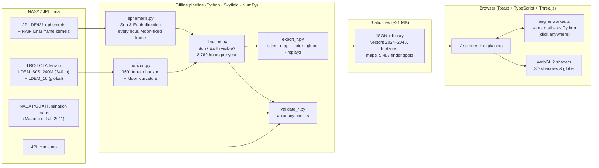
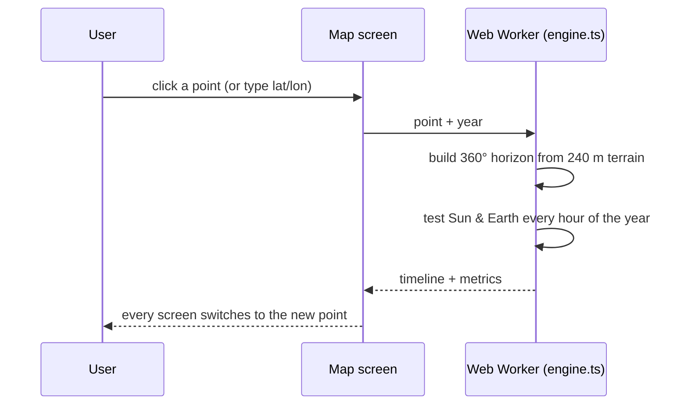
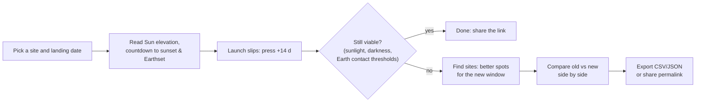

# PPT brief: Lunar Statio, South Pole Mission Planner (7 slides)

**For:** the teammate building the presentation deck
**Event:** NASA Space Apps Challenge 2026 (international judging) · Challenge: *Lunar Landing Site Navigator*
**Team:** Team Stranded · Dr. D.Y. Patil Institute of Technology, Pune
**Live app:** https://lunar-mission-planner-three.vercel.app
**Code:** https://github.com/arnavryie/lunar-landing-navigator (branch `lunar-mission-planner`)

> **Rule for every slide:** each number below can be seen in the live app (or on its Validation page). Don't round, change or add numbers. If you want a number that isn't here, ask the team first. International judges include scientists, and one wrong number costs more than a missing one.

---

## 0. Deck format

| Item | Guidance |
|---|---|
| Slide count | **7 exactly.** Slide 1 = team. Slides 2–7 = content |
| Aspect | 16:9 |
| Background | Dark, warm graphite `#181715` (same as the app) |
| Text colours | Main `#ebe7dd`, secondary `#aaa598`, captions `#8f8b80` |
| **Meaning colours** (use only for these meanings, never as decoration) | Sun / power = amber `#c98419` · Earth / radio contact = blue `#5590d8` · Both = green `#1fa38a` · Neither = grey `#4a515a` · NASA Artemis III regions = magenta `#cf86c3` · Water ice / permanent shadow = pale cyan `#9fd3cf` |
| Font | Archivo (free on Google Fonts); monospaced font for numbers |
| Style | Like a scientific map sheet: thin lines, lots of space, real screenshots. **No emoji, clip-art rockets, cartoon Moons, or stock space photos.** Use screenshots from the live app |
| Text per slide | Max ~40 words on the slide; put the rest in speaker notes |
| Footer on every slide | `Team Stranded · NASA Space Apps 2026 · lunar-mission-planner-three.vercel.app` |

**Tagline (use on slide 1 or 7):**
*"On the Moon, a mission needs two lights to survive: the Sun for power, and the Earth for a voice home."*

---

## Slide 1: Team

**Title:** Lunar Statio · South Pole Mission Planner
**Subtitle:** Sun and Earth above the horizon, hour by hour, for any spot near the Moon's south pole

| Member | GitHub | Role (team to fill in) |
|---|---|---|
| Arnav Ryie | @arnavryie | _ |
| Mohit Aher | @mohitbaher | _ |
| Pratik Sonar | @Mystic945 | _ |
| Sanskar Arnale | @SanskarArnale-07 | _ |

Also on the slide: Team Stranded · Dr. D.Y. Patil Institute of Technology, Pune · Challenge: Lunar Landing Site Navigator · **QR code to the live app** (generate one for `https://lunar-mission-planner-three.vercel.app`).

**Visual:** the front page's polar map (Fig. 1) as a faded background, or a small inset.

---

## Slide 2: The problem

**Headline:** At the lunar south pole the Sun never rises more than about 1.6° above the horizon.

**Points (short, on the slide):**
- The Moon's axis is tilted only ~1.5°, so at the pole the Sun circles just above or below the horizon all lunar day (in 2027 its highest point at the pole is +1.55°).
- So **terrain decides everything**: a ridge a few km away (or mountains 50–100 km away) can put a lander in darkness for days.
- A lander needs **two lights**: the **Sun** for solar power and the **Earth** in view for direct radio contact. Earth bobs up and down by about ±7° each month (libration), so contact comes and goes.
- **When a launch slips by days, a good site can turn into a dark one.** Planners must re-check dates and nearby sites fast.
- NASA tools (QuickMap, Moon Trek, JPL Horizons) have the data, but they're built for experts and are slow for quick "what if" comparisons.

**Who it's for:** mission planners, educators, the public.

**Visual idea:** a simple side-view sketch: flat horizon line, the Sun as a small amber disc just above it, a grey ridge on the left blocking it. Label: "Sun ≤ ~1.6° high · a 1° ridge hides it".

**Speaker note:** "Near the equator you'd just ask 'is it daytime?'. At the south pole that question isn't enough: the Sun skims the horizon, so whether your solar panels get light depends on the hills around you, the exact spot, and the exact date. Change any of those and the answer changes."

---

## Slide 3: Our solution and its features

**Headline:** One web app: pick a spot and a date, see the Sun and Earth against the real terrain, and re-plan in seconds.

**Feature table (7 screens + extras):**

| Screen | What it does |
|---|---|
| **Site and plan** | Horizon dial: the 360° terrain skyline as a ring, with the Sun and Earth moving around it like clock hands. Big numbers: Sun elevation now, countdown to sunset and Earthset. Year-long timeline and seasons, landing-date calendar, slip buttons (+1 d, +7 d, +14 d, +1 lunar month) with before/after changes, a "slip budget", and a battery survival calculator with power in watts |
| **Find sites** | Searches **5,487** candidate spots across 85–90° S for *your* mission window; filters by sunlight, darkness, Earth visibility and slope; ranks the top 5, checked with the exact engine. Can include the landing ellipse (the area you might actually land in) |
| **Globe** | Whole Moon in 3D, lit from the real Sun direction for the chosen hour (NASA colour map + LOLA relief) |
| **Map** | South-pole map (85–90° S): shaded relief, NASA long-term sunlight, permanent shadows (water ice), slope, NASA Artemis III candidate regions. **Click anywhere** (or type coordinates) and a full year of Sun/Earth visibility is computed right in the browser |
| **3D** | 1024×1024 LOLA terrain with real shadows from GPU ray marching, plus a shadow time-lapse |
| **Compare** | 2–4 site/date scenarios side by side, synced timelines, best value per row highlighted, CSV/JSON export |
| **Lander systems** | Rover recharge planner: rover battery and solar setup → nearby sunlit recharge spots, route and energy over time |
| Extras | "Why?" explainer cards (tilt, libration, ridges), Moon-vs-Earth Sun height comparison, **mission replays** (Chandrayaan-3, IM-1 Odysseus), Validation page, shareable links that restore the exact scenario, any landing year (2024–2040 shipped) |

**Sites included:** 14 curated sites (e.g. Shackleton crater, Mons Mouton, Chandrayaan-3 Statio Shiv Shakti, IM-1 and IM-2 landing sites, Nobile crater, Apollo 11 as a reference) plus the 9 NASA Artemis III candidate regions, plus any point you click.

**Visual:** one big screenshot of **Site and plan** (horizon dial + numbers). Add 3 small thumbnails (Map, 3D, Find sites).

**Speaker note:** "The required part of the challenge is showing the Sun and Earth against the horizon. We did that and built the main use case on top: when a mission slips, find a new date or a better spot nearby."

---

## Slide 4: How it works (architecture)

**Headline:** Heavy physics offline in Python; the same maths re-built in the browser, so any point is computed instantly. No server.

**Diagram (flowchart; recreate it as boxes and arrows in the deck):**

**Three steps to explain (one line each):**
1. **Where are the Sun and Earth?** JPL DE421 ephemeris in the Moon's own body-fixed frame, every hour of the year.
2. **What does the skyline look like?** For each spot, the terrain height in all 360 directions from NASA LOLA laser altimetry, including the Moon's curvature (far terrain drops by d²/2R).
3. **Is it visible?** Compare the Sun's and Earth's discs with that skyline, every hour → sunlit %, Earth-in-view %, longest darkness, countdowns.

**"Click anywhere" flow (optional small second diagram):**

**Speaker note:** "Everything runs in your browser. The Python pipeline and the browser engine are checked against each other automatically, so a clicked point gives the same answer as our offline pipeline."

---

## Slide 5: Technology and data

**Headline:** Built on NASA and JPL data; open web technology; no backend.

**Languages:** TypeScript · Python · GLSL (GPU shaders) · CSS · HTML

| Layer | Tools |
|---|---|
| Offline science pipeline | Python, **Skyfield 1.55** (JPL ephemeris), **NumPy** |
| Web app | **React 19**, **TypeScript**, **Vite 8** (build) |
| 3D | **Three.js** with custom GLSL shaders (GPU ray-marched shadows, lit Moon globe), WebGL 2 |
| Speed | **Web Worker** for live computation; precomputed binary data |
| Quality | Automated checks (`check:engine`, `check:ellipse`, `check:years`), oxlint, TypeScript type check |
| Hosting | **Vercel** (static site, auto-deploys from GitHub) |
| AI use (disclose honestly) | Much of the code and docs were written with Claude (Anthropic) via Claude Code under the team's direction. All numbers come from the pipeline and checks, not the AI. No AI-generated images, video or audio |

**Data sources (show the logos or names):**

| Source | Used for |
|---|---|
| NASA LRO **LOLA** terrain (`LDEM_60S_240M`, `LDEM_16`), PDS Geosciences | Terrain horizons, map relief, 3D terrain, slope |
| **JPL DE421** ephemeris + NAIF SPICE kernels | Sun and Earth positions |
| **JPL Horizons** | Independent accuracy check |
| NASA Goddard **PGDA Product 69** (Mazarico et al., 2011) | Long-term sunlight check and map layer |
| NASA SVS **CGI Moon Kit** (LROC) | Globe colour |
| IAU / USGS gazetteer, LROC | Site names and coordinates |
| ISRO (Chandrayaan-3), NASA (IM-1 Odysseus) | Mission replay facts |
| NASA Artemis III candidate regions (Oct 2024) | Map overlay |

**Visual:** a clean two-column layout (tech left, data right). Optional: a strip of small tool logos (React, TypeScript, Python, Three.js, Vercel).

---

## Slide 6: Accuracy and validation (our strongest slide)

**Headline:** Checked against NASA and JPL, not just "looks right".

| Check | Result | Pass mark |
|---|---|---|
| Sun/Earth directions vs **JPL Horizons** (4,326 directions, 3 sites, Jan 2027) | worst error **0.000033°** (0.12 arcseconds) | 0.01° |
| Sunlight % vs **NASA LOLA illumination maps** (80 points, 18.6-year cycle) | correlation **r = 0.991**, median difference 0.31 percentage points | — |
| Earth-in-view % vs the same NASA maps | correlation **r = 0.995**, median difference 0.17 percentage points | — |
| Browser engine vs Python pipeline (8 test points) | direction difference **3.49 × 10⁻⁷°**, yearly % difference **0.00** | 0.001° / 0.5 pp |
| GPU 3D shadows vs pipeline | **191 of 192** agree (the one miss: Sun's upper edge 0.004° from the terrain) | — |
| Fast finder estimate vs exact engine (12 of 5,487 spots, full year) | worst difference **0.28 percentage points** | 3 |

**Mission replays (real-world check):** at their real landing dates, the app shows Sun and Earth visibility for **Chandrayaan-3** (Statio Shiv Shakti, Aug 2023) and **IM-1 Odysseus** (near Malapert A, Feb 2024) next to what ISRO and NASA reported.

**Honest limits (judges respect this, so put them in a small box):**
- Terrain at 240 m per pixel: boulders and features smaller than a pixel aren't seen.
- Mast height fixed at 2 m; no atmosphere (none on the Moon), no thermal model, no radio link budget.
- 3D model sizes are scaled for clarity (labelled on screen); directions are true.

**Visual:** the table above, or a screenshot of the in-app **Validation** page (open the badge in the app's header).

**Speaker note:** "Our worst Sun/Earth direction error is 0.000033 degrees, about 300 times inside our pass mark. The browser and Python give the same answer, and our sunlight map agrees with NASA's own published map at r = 0.99."

---

## Slide 7: Demo story, impact and next steps

**Headline:** A launch slips 14 days. Is our site still good, and if not, where should we go?

**User workflow (diagram):**

**Impact (3 bullets):**
- Turns hours of expert-tool work into a **seconds-long "what if"** for any date or spot.
- Makes a hard idea visible: **why a few km or a few days change everything** at the pole.
- Fully open, free, runs in any browser, with every number traceable to its NASA/JPL source.

**What's next:** relay-satellite visibility (for when Earth is hidden), finer terrain near key sites, a printable site assessment report.

**Close with:** the tagline + QR code + live link: **https://lunar-mission-planner-three.vercel.app**

**Speaker note (live demo, ~60 s if allowed):** open Site and plan → read the Sun numbers → press +14 d → verdict changes → Find sites → Compare.

---

## Screenshots to take (from the live app, at 1440×900 or larger)

| For slide | Open | What to capture |
|---|---|---|
| 1, 2 | https://lunar-mission-planner-three.vercel.app | Front page polar map (Fig. 1) |
| 3 | Open the planner → **Site and plan** | Horizon dial + big numbers |
| 3 | **Map** tab | Map with sunlight layer and Artemis III regions |
| 3 | **3D** tab | Terrain with shadows (press play for the time-lapse) |
| 3, 7 | **Find sites** tab | Ranked top 5 |
| 7 | **Compare** tab | Two scenarios side by side |
| 6 | Header badge → **Validation** page | Results table |
| 6 | Site picker → "Replay: Chandrayaan-3" | Replay panel on Site and plan |

Tip: use the browser's zoom at 100% and hide bookmarks bars; crop to the content, no browser chrome.

---

## Glossary (for the presenter)

| Term | Meaning |
|---|---|
| Ephemeris | A table of where the Sun, Earth and Moon are at each moment |
| LOLA | Lunar Orbiter Laser Altimeter on NASA's LRO; measured the Moon's height map with lasers |
| Horizon mask | The height of the skyline in each of 360 directions around a spot |
| Libration | The Moon's slight wobble as seen from Earth; makes Earth rise and set slowly in the polar sky |
| DTE | Direct-to-Earth radio contact (no relay satellite) |
| PSR | Permanently shadowed region: crater floors that never see the Sun, where water ice can survive |
| Landing ellipse | The area the lander could actually touch down in (a probability boundary, not a guarantee) |
| Slip | A delay to the landing date |
| pp | Percentage points (e.g. 60% → 62% is +2 pp) |
